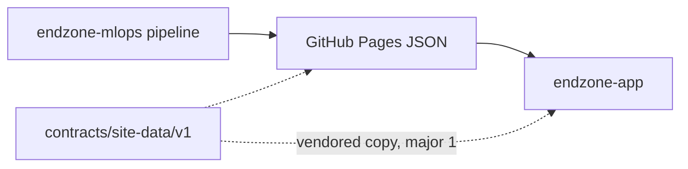

# endzone-app

Android and iOS client for the weekly NFL win probabilities published by [endzone-mlops](https://github.com/carloshgalvan95/endzone-mlops). Android is the first native target. The same Expo project is the iOS client later.

Version 0.3.1. Application id `io.github.carloshgalvan95.endzone`. The app reads site data contract major version 1 and nothing else. It does not ship a model and it is not betting advice. It does not show a market comparison.

## Architecture



endzone-mlops scores the week and writes JSON. GitHub Pages serves that JSON at `https://carloshgalvan95.github.io/endzone-mlops/data/`. The schemas stay in the MLOps repo. This app vendors major version 1 from commit `b9f8342c4e24009ce74a942d82b285626259a43e` under `contracts/v1/` and checks every file with those schemas before drawing it.

| File                                | Role                                                 |
| ----------------------------------- | ---------------------------------------------------- |
| `latest.json`                       | Current slate. Home screen when no week is selected. |
| `predictions/<season>-w<week>.json` | One week, same shape as `latest.json`.               |
| `teams.json`                        | Names, colors, and logo URLs.                        |
| `track_record.json`                 | Derived record. The Record screen reads it.          |
| `sample.json`                       | Example slate (`sample: true`).                      |

A missing `contract_version` means major 1, because files published before the field existed are still valid. A different major shows an update state instead of rendering a shape this version does not know.

## Screens

1. Week, the home screen. Season and week, one card per game. Each card shows both teams, the model favorite in tens, and the final score when the game is final. Loading, empty, error, offline, and contract-update states are on this screen.
2. Historial. Season correct calls, then one row per week from `pick_hits` and `pick_misses`. It does not compare log loss.
3. How it is calculated. Six steps. Step 6 says the method is public and links to the model card. It does not print a comparison.
4. Game detail. Tap a game. It shows the model favorite, kickoff in the phone's local time, and the result when the game is final.
5. Alerts. A Tuesday local notification, off until you turn it on. It stays on the phone. There is no push server.

## Widget and logos

The Android home screen widget is built with `react-native-android-widget` 0.26.0. It does not run in Expo Go. Use a development build (`npx expo run:android`) on Android 12 and 14. It shows the next kickoff, refreshes at most every 60 minutes, and opens `endzone://game/{id}`.

The widget asks the library for Jost (`Jost_400Regular`, `Jost_700Bold`). A prebuild plugin copies those files into `android/app/src/main/assets/fonts`, which is where this library loads a bundled face. If a file is missing, the library uses the system face at weight 700. That system face is acceptable only on the widget. The app itself keeps Jost.

Team logos load at runtime from the contract logo URLs. They are not stored in this repo or in the APK. `teamLogos.enabled` in `src/config/features.ts` is on for now. Turn it off before any store submission. Logos are third-party trademarks. See [docs/team-logos.md](docs/team-logos.md).

## Download

Release files are split by CPU so a phone does not download every architecture. On a recent phone, install `endzone-<version>-arm64-v8a.apk`. On an older 32-bit phone, install `endzone-<version>-armeabi-v7a.apk`. The universal file contains both and is the larger download. See [docs/release.md](docs/release.md).

## Run

Node.js 22.

```bash
npm install
npx expo start
```

Then open the project in Expo Go on Android, or press `a` for an emulator. iOS needs macOS.

Checks:

```bash
npm run typecheck
npm run lint
npm run format:check
npm test
npm run contract:check
```

`contract:check` needs the network. It downloads the live JSON and validates it against `contracts/v1/`.

## Contract policy

- Pin major version 1. Schemas are `contracts/v1/*.schema.json`. Checksums are in `contracts/v1/checksums.json`. The checksum test fails if a schema file changes without a new recorded digest.
- Runtime parsing is Ajv against those schemas. See `src/contract/validate.ts`.
- Do not guess a newer major from an unknown field. Unknown fields fail the publisher's check before they are deployed. A `contract_version` whose major is not 1 is an update state.
- An additive optional field can stay on major 1. A removal, a rename, or a type change is a new major in endzone-mlops, then an app update.
- `.github/workflows/contract-drift.yml` runs on demand and every Monday. It fetches the live JSON and fails if the files no longer match the vendored schemas.

## Design

Colors, type, and spacing follow the site tokens (cream, black, blue, crimson, yellow, dark surfaces). `src/theme/tokens.ts` is the typed copy. The app follows the system color scheme and defaults to dark, which is the site default. The icon and splash are the mark on `#1B1F23`. The wordmark in the header is the horizontal logo. The light wordmark is the same drawing with cream ink swapped to `#151515` so it can sit on the cream surface.

## Release

Semantic versions. The app version in `package.json` and `app.json` is `0.3.1`, and `android.versionCode` is `4`. A GitHub release tag `vX.Y.Z` builds signed Android APKs split by CPU. See [docs/release.md](docs/release.md). The signing keystore is created by hand and stored as GitHub Actions secrets. It is never generated or committed here.

## License

MIT. See [LICENSE](LICENSE).
